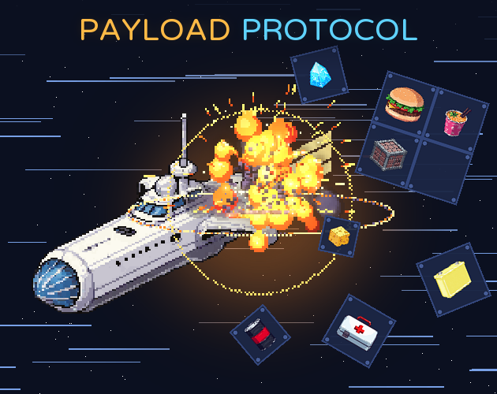
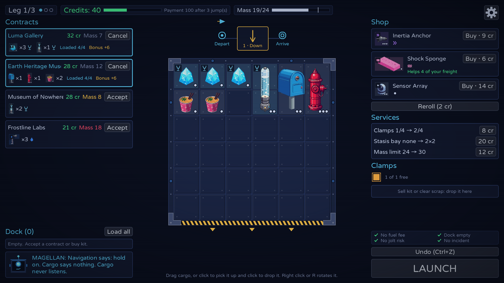
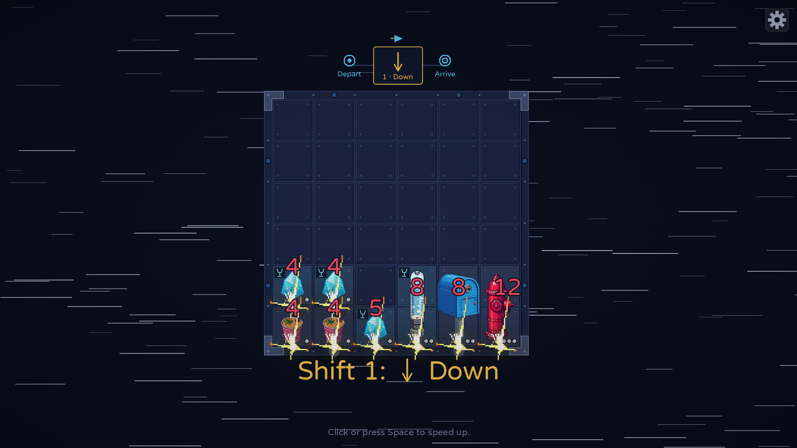
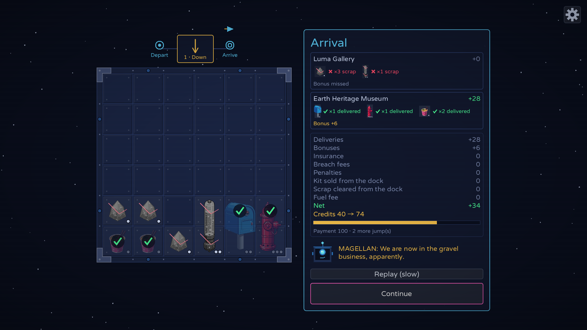
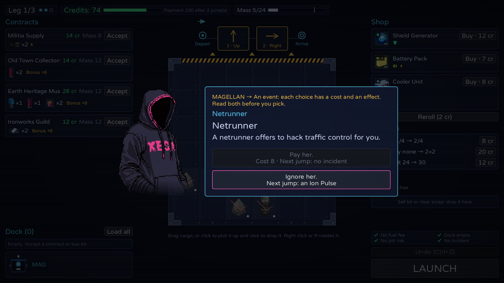
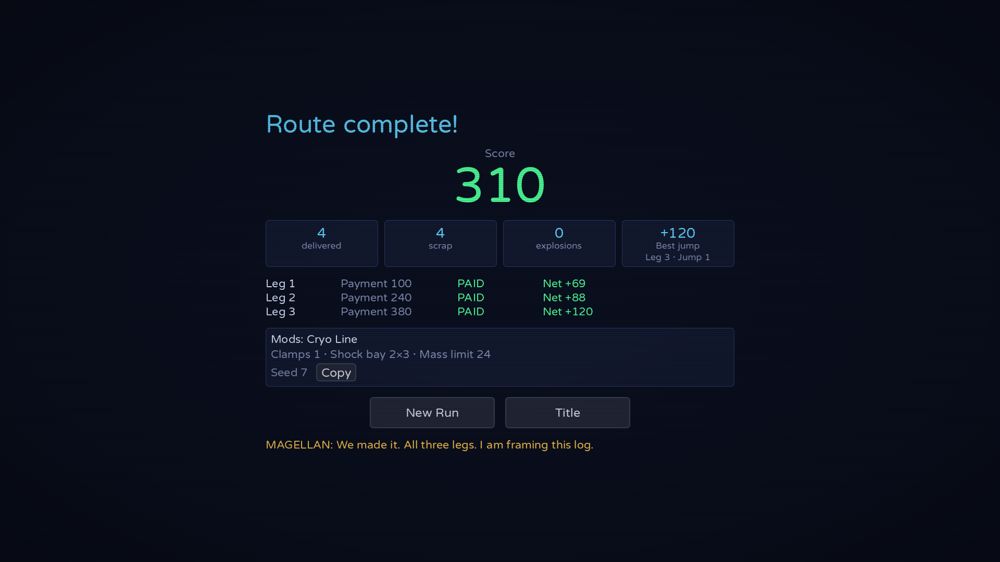

# Payload Protocol

<p align="center"><a href="https://1slu.itch.io/payload-protocol"></a></p>

**Pack the hold. Survive the warp.**

**[Play in your browser on itch.io](https://1slu.itch.io/payload-protocol)** · Made for [GitHub Game Off 2026](https://itch.io/jam/game-off-2026)

Payload Protocol is a short puzzle game about cargo in the hold of a spaceship. You pack freight into a grid. Then the ship warps, and every piece of cargo slides across the hold. Crystals shatter, fuel drums explode, and coolant leaks onto the electronics. Plan for the shift, or pay for the scrap.

[](https://1slu.itch.io/payload-protocol)

## How to Play

1. **Take contracts.** Each contract gives you freight to deliver at the next station. The hold is never big enough for all of them.
2. **Pack the hold.** Drag the freight into the grid. The route above the hold shows each shift of the next jump.
3. **Launch.** In each shift, all cargo slides to a wall or to cargo that stopped. A heavy cargo hits hard. Fragile freight breaks, Volatile freight explodes, and Fluid freight leaks.
4. **Get paid.** Intact freight pays at the arrival. Scrap stays in your hold and takes space.
5. **Make the payment.** At the end of each leg, you pay the loan. Three legs make a run.

Use what the shop sells: clamps hold cargo in place, Shock Sponges soften hits, Coolers keep food fresh, and Shields stop one disaster in each jump. Events and ship mods change each run.

## Controls

| Action | Mouse | Keyboard |
| --- | --- | --- |
| Pick up and drop cargo | Drag, or click and click | |
| Rotate the held cargo | Right click | R |
| Undo at the station | Undo button | Ctrl+Z |
| Speed up the warp | Click | Space |
| Pause | Gear button | Esc |

The first New Run starts a short tutorial. You can skip it, and start it again from the title.

## Features

- A full run in about 20 to 30 minutes: 3 legs, 9 jumps, and a payment at the end of each leg.
- Every shift is shown before the warp. You can read each hit before it happens.
- Freight with traits that react: Fragile, Volatile, Fluid, Electronic, and Perishable.
- Special contracts: VIP clients, long hauls, and the Black Market.
- Route environments and incidents: Low Gravity, Heat Zone, meteors, and hull breaches.
- English and Traditional Chinese (繁體中文).

| | |
| --- | --- |
|  |  |
|  |  |

## Credits

- Game: islu
- Cargo and speaker art: [FreePixel](https://freepixel.art)
- Effects: [pixelfx](https://github.com/patch-gg/pixelfx) by Patch and Hugo Duprez (MIT)
- Sounds: [Kenney](https://kenney.nl) (CC0)
- Music: "Vintage Menu" by iamoneabe ([OpenGameArt](https://opengameart.org/content/vintage-menu), CC0)
- Font: jf open huninn 2.1 by justfont (SIL OFL 1.1)
- Made with [Godot 4.7](https://godotengine.org)

## License

- **Code:** the GDScript code and the tool scripts have the [MIT License](LICENSE).
- **Assets:** the art, the music, the font, and the effect sheets are not under the MIT License. Other creators made them. [docs/assets.md](docs/assets.md) gives the source and the license of each file.

## For Developers

The game is GDScript only, and it runs in a browser.

- Game design: [docs/spec.md](docs/spec.md)
- Architecture and code rules: [CLAUDE.md](CLAUDE.md)
- The text of the itch.io page: [docs/itch.md](docs/itch.md)

### Requirements

- [devbox](https://www.jetify.com/devbox). It installs Task, uv, and Node.js at fixed versions.
- Godot 4.7 as `godot` on your `PATH`. To use a different binary, set `GODOT=/path/to/godot`.

### Setup

```sh
devbox shell
task import
task run
```

To open the project in the Godot Project Manager, import `project/project.godot`. The repository root is not a Godot project.

### Tasks

| Command | Action |
| --- | --- |
| `task import` | Import the project. Run after a clone. |
| `task run` | Run the game |
| `task editor` | Open the Godot editor |
| `task test` | Run the rule tests |
| `task test:ui` | Play a full run through the screens, headless |
| `task play -- help` | The text player |
| `task smoke` | Run the game headless for 5 frames |
| `task shots` | Take screenshots of each screen into `shots/` |
| `task export:web` | Export the web build to `build/web` |
| `task zip:web` | Export the web build, and zip it for itch.io into `build/` |
| `task serve:web` | Serve `build/web` at <http://localhost:8060> |
| `task i18n` | Collect the text for translation into `project/locale/` |
| `task sfx` | Make the placeholder sounds |
| `task fx` | Make the effect sheets with pixelfx |
| `task art` | Make the cargo images and the speaker portraits from FreePixel images, and draw the project icon and the images of the itch.io page |
| `task fmt` | Format the GDScript code |
| `task lint` | Lint the GDScript code, and check the format |
| `task check` | Run lint, the tests, the UI check, and smoke |
| `task check:quiet` | Run `task check`. Print only the failures. |

Run `task check` before each commit.
